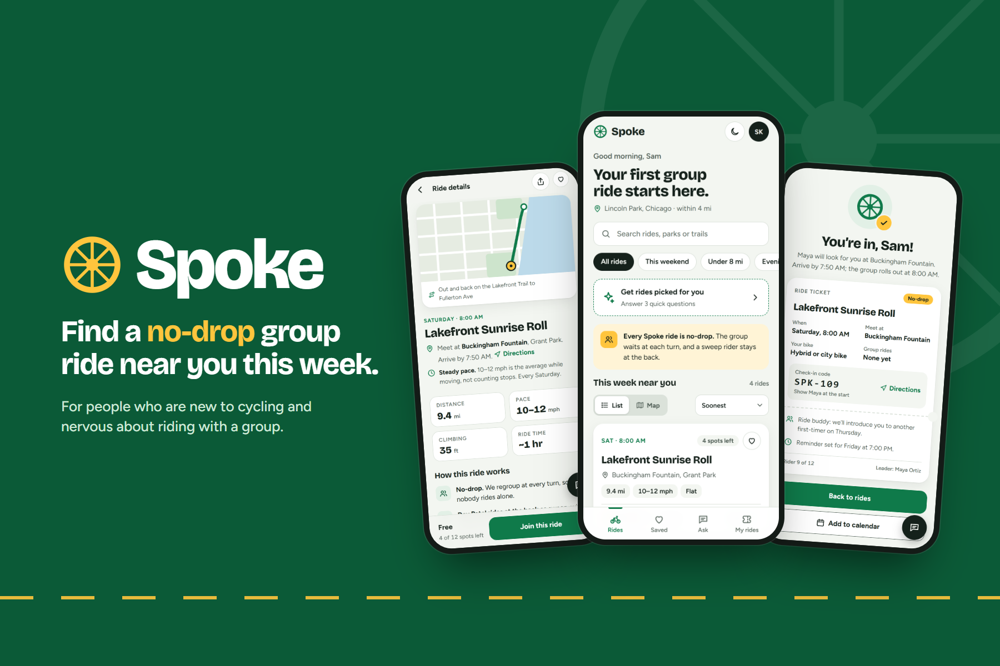

# Meet-Spoke

**Spoke** helps people who are new to cycling find and join a beginner-friendly, **no-drop** group ride, where the group waits for everyone.



This repo holds a working, clickable prototype of the app. It also has the plan and copy-paste prompts for rebuilding it in Figma Make, the submission text, market research, and an automated test suite.

## Try it

Open [`prototype/index.html`](prototype/index.html) in any browser. It's a single file with no build step. On a computer it shows inside a phone frame; on a phone it fills the screen.

The main flow: **Home → Details → Join → Done**, with working back navigation.

## What's in the prototype

| Area | Features |
|---|---|
| **Find a ride** | Search, filters (weekend, under 8 mi, evenings), sort, list or map view, ✦ "Picked for you" from 3 quick questions |
| **Ride details** | Route map, distance, pace level ("average while moving, not counting stops"), how the ride works (no-drop, sweep rider), ride leader, what to bring, directions |
| **Join** | Pick your bike (including bike share), experience level, ride buddy, reminder, privacy promise |
| **Done** | Ride ticket with check-in code, add to calendar, invite a friend |
| **Your rides** | Saved rides (♥), My rides with tickets, waitlist for full rides, release a spot with Undo |
| **Ask Spoke (AI assistant)** | Knows every ride and your bookings. Inside claude.ai it answers with Claude (streamed, with voice in and read-aloud); everywhere else a built-in helper answers from the same data. It understands typos, follow-ups like "where do we meet for it?" and two-part questions, and puts Join, Save and Directions buttons under its answers. |
| **Everywhere** | Dark mode, keyboard shortcuts (`/` search, `Esc` back), swipe back on phones, no server or build step needed, remembers your bookings |

All riders and ride leaders are made up. Places are real Chicago locations.

## Project files

| Path | What it is |
|---|---|
| [`prototype/index.html`](prototype/index.html) | The whole app: HTML, CSS and JavaScript in one file |
| [`prototype/screens/`](prototype/screens/) | Phone screenshots of the main screens |
| [`cover.png`](cover.png) | 1800 × 1200 cover image |
| [`START-HERE.md`](START-HERE.md) | Step-by-step plan and Figma Make prompts |
| [`SUBMISSION.md`](SUBMISSION.md) | Title, description and checklist for the submission form |
| [`MARKET-RESEARCH.md`](MARKET-RESEARCH.md) | How Spoke compares to Strava, Komoot and other ride apps, with sources |
| [`tests/`](tests/) | Automated browser tests, cover generator, Lighthouse audit |

## Run the tests

You need [Node.js](https://nodejs.org/) 18 or newer and Google Chrome. If Chrome is installed somewhere unusual, set `CHROME_PATH` to its executable.

```bash
npm install
npm test            # 211 checks in a real headless Chrome
npm run lighthouse  # Google Lighthouse scores, mobile + desktop
npm run cover       # rebuild cover.png from the screenshots
```

`npm test` covers:
- Every screen, button and back route, including the browser Back button, keyboard shortcuts and swipe-back.
- Search, filters, sort, map view, saving, waitlist, release with Undo, and bookings surviving a reload.
- The AI assistant, both the built-in helper and a simulated Claude connection: streaming, Stop, declined permission, voice, and the safety checks (typed HTML is never run; made-up ride IDs are dropped).
- Accessibility scans (axe-core, WCAG 2.1 AA) of 12 views in light and dark mode: 11 at phone size, 1 at desktop size.
- No sideways scrolling or cut-off content on 8 screens at 9 widths, in both themes.

It also regenerates the screenshots in `prototype/screens/`.

Last Lighthouse run:

| | Performance | Accessibility | Best Practices | SEO |
|---|---|---|---|---|
| Mobile | 99 | 100 | 100 | 90 |
| Desktop | 98 | 100 | 100 | 90 |

The one SEO point lost is the page description. The page is built to run inside the claude.ai artifact viewer, which places the page content, meta tags included, inside the document body, where search engines don't read them.
